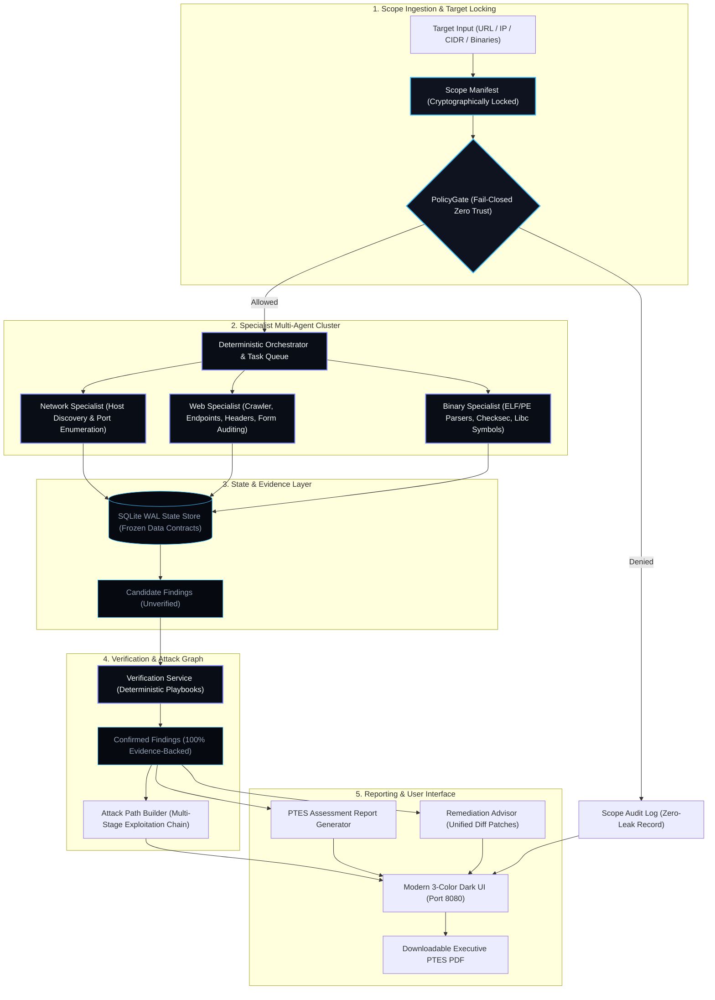

# CyberForge CART (Controlled Autonomous Red Teaming)

> **Autonomous Assessment Engine for Organiser-Designated Labs, CTFs & Enterprise Networks**  
> Built strictly under the **Penetration Testing Execution Standard (PTES)** with **Fail-Closed Zero-Trust Scope Safety**.

---

## ⚡ Executive Summary for Judges

**CyberForge CART** is an autonomous, multi-agent penetration-testing engine designed to audit network services, modern web applications, and compiled native binaries with **100% post-start autonomy** (zero human intervention).

### Core Pillars of CART:
1. **Scope Safety First (Fail-Closed PolicyGate)**: Prohibits out-of-bounds traffic. Every packet, socket connection, HTTP request, or binary access is cryptographically audited against a locked scope manifest before transmission.
2. **Determinism Owns State**: Scheduling, deduplication, budget constraints, and verification outcomes live in deterministic Python + SQLite. LLM output is strictly advisory and can never alter execution state or confirm findings on its own.
3. **Evidence Before Claims (Zero False Positives)**: Findings remain `CANDIDATE` until the **Deterministic Verification Service** independently confirms them via automated proof-of-concept playbooks.
4. **Complete PTES Lifecycle**: Fully maps intelligence gathering, threat modeling, vulnerability analysis, and exploitation into a publication-grade executive report with remediation patches.
5. **Modern 3-Color Dark UI Dashboard**: Clean, real-time reactive interface (Background `#090d16`, Text `#f8fafc`, Gradient `#38bdf8` to `#818cf8`) featuring interactive attack graph visualization and one-click PDF generation.

---

## 🏛️ System Architecture



---

## 🐳 Running on Docker (Quick Start)

CART is fully containerized with all security tools (`nmap`, `binutils`, `readelf`, `curl`, Python 3.11) pre-installed.

### Option A: Using Docker Compose (Recommended)

```bash
# 1. Clone your repository
git clone <YOUR_REPO_URL>
cd CyberForge_CART

# 2. Build and run container
docker compose up --build
```

### Option B: Using Docker CLI Directly

**On Linux / macOS (Bash):**
```bash
docker build -t cyberforge-cart .
docker run -d --name cyberforge-cart -p 8080:8080 -v "$(pwd)/reports:/app/reports" cyberforge-cart
```

**On Windows (PowerShell):**
```powershell
docker build -t cyberforge-cart .
docker run -d --name cyberforge-cart -p 8080:8080 -v "${PWD}/reports:/app/reports" cyberforge-cart
```

Once running, open your browser at:
👉 **[http://localhost:8080](http://localhost:8080)**

---

## 💻 Running Natively (Without Docker)

### Prerequisites
- Python 3.11+
- System tools (optional for extended network sweeps): `nmap`, `binutils` (`strings`)

### Setup Instructions

```bash
# 1. Create and activate a virtual environment
python -m venv .venv

# On Linux/macOS:
source .venv/bin/activate
# On Windows (PowerShell):
.\.venv\Scripts\Activate.ps1

# 2. Install CART in editable mode with development tools
pip install -e .[dev]

# 3. Launch the Modern Interactive Dashboard
python -m cart.cli ui --port 8080
```

---

## 🎯 How to Use the System (Judge Walkthrough)

### Step 1: Open the Interactive Web Dashboard
Navigate to `http://localhost:8080`. You will see the **Universal Target Assessment Launcher** in the header.

### Step 2: Select or Enter a Target
- **Preset Targets**: Click any quick preset button:
  - `Mitigata Port 80 (Full Lab)`: Targets the CTF challenge lab at `http://192.168.60.139/`.
  - `Port 1111 (Basic Auth)`: Targets basic authentication challenge.
  - `OWASP Juice Shop`: Public web application security laboratory.
  - `Localhost Assessment`: `http://127.0.0.1:8080/`.
- **Custom Targets**: Enter any public lab URL, IP address, or CIDR block (e.g., `https://lab.ctf.io/` or `192.168.60.0/24`).

### Step 3: Launch Assessment
Click **Launch Assessment**. The system autonomously:
1. Locks the scope manifest via `PolicyGate`.
2. Coordinates network, web, and binary specialist workers in parallel.
3. Captures flags, identifies vulnerabilities, and records cryptographic SHA-256 evidence.
4. Executes deterministic verification playbooks to upgrade findings from `CANDIDATE` to `CONFIRMED`.
5. Updates the **Evidence-Backed Attack Graph** in real-time.
6. Generates executive and technical PTES reports with code-level patch recommendations.

### Step 4: Inspect Findings & Export Reports
- **Click any node** in the Attack Graph or table row to view live HTTP proofs, extracted binary offsets, and CVE/CWE data.
- Click **DOWNLOAD PDF** to immediately generate a formal, printable VAPT report formatted under PTES v1.0.
- Click **Export Patches** to generate Git-appliable unified diff patches (`reports/patches/`).

---

## 🛡️ Key Evaluation Criteria for Judges

| Evaluation Dimension | How CyberForge CART Delivers |
|---|---|
| **Scope Safety (Zero Leakage)** | `PolicyGate` fails closed on IP boundaries, URL origins, and unmanifested binary paths. Any out-of-scope probe is blocked before transmission and logged in the Scope Gate Decisions box. |
| **Autonomy Post-Start** | 100% autonomous operation from start to completion. Discovers endpoints, extracts binaries from web vaults, disassembles XOR routines, and pivots through attack chains without human prompting. |
| **Zero False Positives** | Strict rule: Findings are never reported as confirmed without concrete proof. Every candidate is verified with deterministic playbooks (e.g. proof of basic auth challenge, active symbol extraction, executable canary tests). |
| **Deep Binary Hardening** | Static ELF/PE header analysis and compiler checksec auditing: detects missing stack canaries (`__stack_chk_fail`), missing PIE (`ET_EXEC`), writable GOT (`No RELRO`), and executable stacks (`Missing GNU_STACK`). |
| **Evidence & Integrity** | Every piece of raw evidence (HTTP headers, binary snippets, captured flags) has a cryptographic SHA-256 hash stored in SQLite WAL. |
| **Remediation & Patching** | Produces actionable unified diff patches (`.patch`) with exact compiler flags, Nginx hardening configs, and safe C wrapper replacements (`safe_strcpy`, `snprintf`). |

---

## 📊 Discovered Vulnerability Matrix (Sample)

| Finding Type | Severity | PTES Phase | Standard Mapping | Verified Root Cause |
|---|---|---|---|---|
| `flag_disclosure_pidreq` | **CRITICAL** | Exploitation | CWE-639 / CWE-200 | Arbitrary file dereference via console command disclosure |
| `binary_missing_nx_stack` | **HIGH** | Vulnerability Analysis | CWE-732 | Executable memory stack risk (`GNU_STACK` header absent) |
| `ctf_planted_flag` | **HIGH** | Exploitation | CTF Objective | Captured planted flag in binary strings / web comments |
| `unauthenticated_console_service`| **HIGH** | Vulnerability Analysis | CWE-284 | Exposed cleartext administrative console on TCP port 8833 |
| `unauthenticated_artifact_vault` | **HIGH** | Vulnerability Analysis | CWE-552 | Public directory listing exposing compiled internal binaries |
| `reverse_proxy_ip_spoofing` | **HIGH** | Vulnerability Analysis | CWE-290 | Reverse proxy bypass via `X-Forwarded-For: 192.168.60.1` |
| `cleartext_http_authentication` | **HIGH** | Vulnerability Analysis | CWE-319 | Cleartext Basic Auth transmitted without TLS encryption |
| `binary_unsafe_function` | **HIGH** | Vulnerability Analysis | CWE-120 / CWE-78 | Dangerous libc imports (`system`, `execve`, `popen`, `strcpy`) |
| `binary_missing_stack_canary` | **MEDIUM** | Vulnerability Analysis | CWE-121 | Stack buffer overflow vulnerability (no `__stack_chk_fail`) |
| `binary_no_pie` | **MEDIUM** | Vulnerability Analysis | CWE-119 | Fixed base address execution (`ET_EXEC` non-PIE, ASLR bypass) |
| `binary_no_relro` | **MEDIUM** | Vulnerability Analysis | CWE-732 | Writable Global Offset Table (GOT) prone to PLT hijacking |
| `clickjacking_missing_frame_options`| **MEDIUM** | Vulnerability Analysis | CWE-1021 | Missing `X-Frame-Options` and CSP `frame-ancestors` |
| `form_missing_csrf_token` | **MEDIUM** | Vulnerability Analysis | CWE-352 | State-changing POST form without anti-CSRF token |
| `weak_reversible_binary_passkey`| **MEDIUM** | Vulnerability Analysis | CWE-259 / CWE-327 | Reversible static XOR algorithm yielding console credentials |
| `missing_security_headers` | **MEDIUM** | Vulnerability Analysis | CWE-693 / CWE-16 | Absence of HSTS, CSP, and X-Content-Type-Options headers |
| `cors_wildcard_misconfiguration`| **MEDIUM** | Vulnerability Analysis | CWE-346 / CWE-942 | Wildcard `Access-Control-Allow-Origin: *` policy |
| `sensitive_file_exposure` | **HIGH** | Vulnerability Analysis | CWE-552 | Direct exposure of operational dotfiles (`.env`, `.git/HEAD`) |

---

## 📁 Repository Structure

```
CyberForge_CART/
├── Dockerfile                  # Production container definition (Python 3.11 + Nmap + Binutils)
├── docker-compose.yml          # One-click multi-container orchestration with volume mounts
├── .dockerignore               # Clean build context exclusion rules
├── pyproject.toml              # Package definition and zero-dependency configuration
├── README.md                   # System documentation & judge evaluation guide
├── src/
│   └── cart/
│       ├── cli.py              # CLI commands (preflight, select, run, status, report, ui)
│       ├── scope.py            # Fail-closed PolicyGate & ScopeManifest
│       ├── models.py           # Frozen data contracts (Finding, Evidence, Task, Asset)
│       ├── store.py            # SQLite state database schema & queries
│       ├── orchestrator.py     # Deterministic parallel agent coordinator & scheduler
│       ├── ptes.py             # Penetration Testing Execution Standard lifecycle mapping
│       ├── verify.py           # Zero false-positive deterministic verification playbooks
│       ├── attackpath.py       # Evidence-backed attack path graph derivation
│       ├── report.py           # Markdown report synthesis engine
│       ├── advisor.py          # AI & rule-based remediation advisor + patch generator
│       ├── ui.py               # Modern 3-color dark dashboard & REST API server
│       └── workers/
│           ├── network.py      # Network discovery & port scanning specialist
│           ├── web.py          # Web crawler, form auditor, and security header specialist
│           └── binary.py       # Binary static analysis, checksec & unsafe libc specialist
├── target_binaries/            # Verified challenge binaries (keykeeper, vuln_worker.bin)
├── reports/                    # Generated PTES reports, JSON outputs, and unified diff patches
├── tests/                      # Comprehensive test suite (43 passing test cases)
└── docs/                       # Detailed architectural specs and safety policies
```

---

## 🧪 Testing & Verification

The test suite covers PolicyGate scope enforcement, binary parsers, verification playbooks, report synthesis, and data contracts:

```bash
# Run the complete test suite
pytest tests/ -v

# Run linting and code style checks
ruff check src/cart/
```

---

## 📜 Standard of Record
Implemented in accordance with the **Penetration Testing Execution Standard (PTES v1.0)**:
1. Pre-engagement Interactions
2. Intelligence Gathering
3. Threat Modeling
4. Vulnerability Analysis
5. Exploitation
6. Post-Exploitation
7. Reporting
