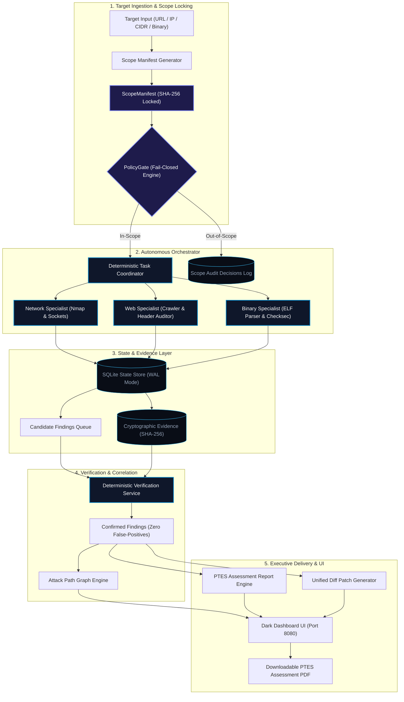
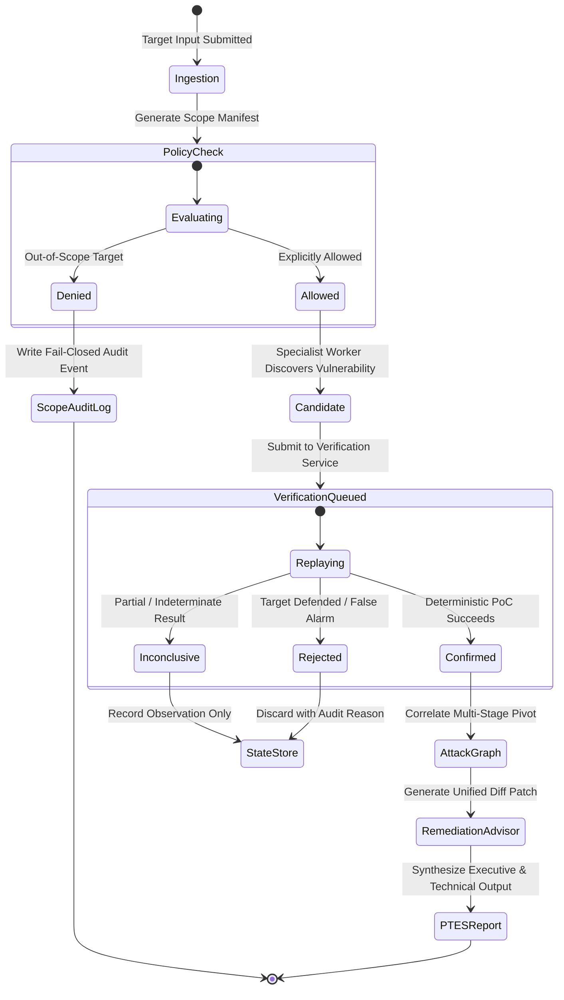
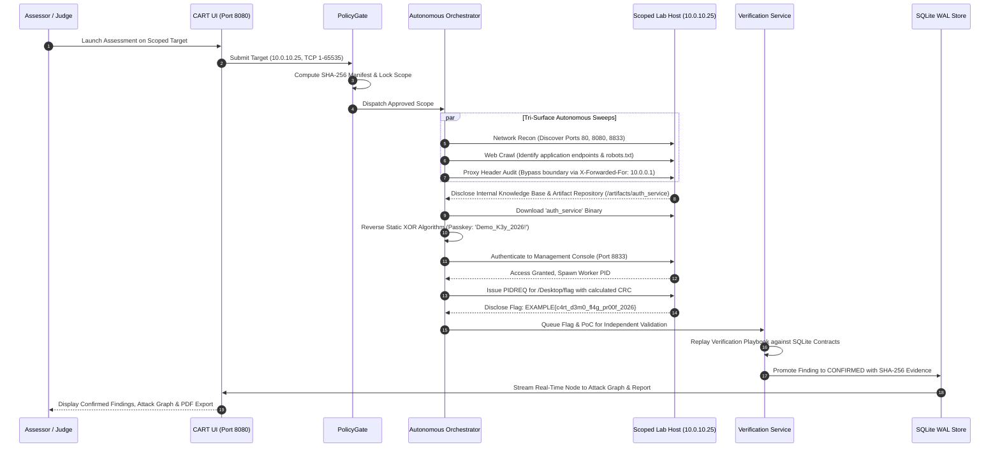

# CyberForge CART
### Controlled Autonomous Red Teaming & Assessment Engine

[](http://www.pentest-standard.org/)
[](docs/safety.md)
[](src/cart/verify.py)
[](tests/test_cart.py)
[](pyproject.toml)
[](Dockerfile)
[](AGENTS.md)

---

## Executive Overview

**CyberForge CART** (Controlled Autonomous Red Teaming) is an enterprise-grade autonomous security assessment engine designed for organiser-designated CTF laboratories, hybrid cloud infrastructures, and scoped enterprise perimeters. 

Operating under the strict lifecycle of the **Penetration Testing Execution Standard (PTES)**, CART coordinates bounded, specialized worker agents across three concurrent attack surfaces: **Network Infrastructure**, **Web Applications**, and **Native Compiled Binaries**.

Unlike fragile LLM-only scanners, CART is built on the fundamental principle of **Deterministic State Ownership**: scheduling, scope enforcement, deduplication, evidence hashing, and vulnerability verification are governed entirely by deterministic Python and SQLite state machines. AI and heuristics remain strictly advisory and can never mutate state or promote unverified claims.

---

## Architectural Principles

```
  ┌────────────────────────────────────────────────────────────────────────┐
  │                           CORE PILLARS OF CART                         │
  ├──────────────────────────────────┬─────────────────────────────────────┤
  │ 1. Zero-Trust Scope Safety       │ Fails closed on all outbound probes │
  │ 2. Deterministic State Ownership │ SQLite WAL core; zero LLM drift     │
  │ 3. Evidence Before Claims        │ 100% verified PoCs; no hallucinations│
  │ 4. Full Tri-Surface Auditing     │ Network + Web + Binary Static/ELF   │
  │ 5. Actionable Remediation        │ Git-appliable unified diff patches  │
  └──────────────────────────────────┴─────────────────────────────────────┘
```

1. **Zero-Trust Scope Safety (`PolicyGate`)**:
   Every packet, socket handshake, HTTP probe, or binary file request is evaluated against a cryptographically locked `ScopeManifest` before transmission. If an IP, CIDR prefix, domain, or file hash is not explicitly pre-approved, the gate drops the request immediately and records the violation in the audit log.
2. **Deterministic State Machine**:
   Task dependencies, rate limits, timeouts, and state transitions are executed in deterministic code. The core system runs locally without requiring cloud API keys or external LLM connections.
3. **Evidence-Backed Verification**:
   Vulnerabilities are never confirmed on suspicion. Findings enter the state machine as `CANDIDATE` and must pass deterministic verification playbooks to be promoted to `CONFIRMED`. Unproven items are strictly marked `INCONCLUSIVE` or `REJECTED`.
4. **Tri-Surface Coverage**:
   - **Network**: TCP/UDP discovery, state tracking, service fingerprinting, and cleartext protocol analysis.
   - **Web**: Origin-pinned link crawling, security header inspection, CSRF token validation, reverse-proxy bypass testing (`X-Forwarded-For`), and sensitive file detection.
   - **Binaries**: Static ELF/PE structural analysis, compiler checksec auditing (`NX`, `PIE`, `Canary`, `RELRO`), unsafe libc symbol detection (`strcpy`, `system`, `gets`, `popen`), and XOR algorithm reversing.
5. **Unified Remediation Advisory**:
   Translates confirmed weaknesses directly into concrete mitigation guidance, hardened configuration snippets, and Git-compatible unified diff patches (`.patch`).

---

## System Architecture

### High-Level Architecture Diagram



---

### Verification Lifecycle State Machine



---

### End-to-End Exploitation Sequence



---

## Deployment & Usage

### Option 1: Docker Deployment (Recommended)

CyberForge CART includes a self-contained, multi-stage Docker environment with `nmap`, `binutils`, `readelf`, `curl`, and Python pre-configured.

#### Using Docker Compose
```bash
# 1. Clone repository
git clone https://github.com/EDITH-KRP/MITIGATA_Hackthon.git
cd MITIGATA_Hackthon

# 2. Build and start container in detached mode
docker compose up --build -d

# 3. View live operational logs
docker compose logs -f
```

#### Using Docker CLI Directly

**Linux / macOS (Bash):**
```bash
docker build -t cyberforge-cart .
docker run -d --name cyberforge-cart \
  -p 127.0.0.1:8080:8080 \
  -v "$(pwd)/reports:/app/reports" \
  -v "$(pwd)/cart.db:/app/cart.db" \
  cyberforge-cart
```

**Windows (PowerShell):**
```powershell
docker build -t cyberforge-cart .
docker run -d --name cyberforge-cart `
  -p 127.0.0.1:8080:8080 `
  -v "${PWD}/reports:/app/reports" `
  -v "${PWD}/cart.db:/app/cart.db" `
  cyberforge-cart
```

Open your browser at: **`http://localhost:8080`**

---

### Option 2: Native Host Installation

#### Prerequisites
- Python 3.11 or newer
- `pip` and `virtualenv`
- Optional: `nmap`, GNU `binutils` (`strings`, `readelf`)

```bash
# 1. Clone repository
git clone https://github.com/EDITH-KRP/MITIGATA_Hackthon.git
cd MITIGATA_Hackthon

# 2. Create and activate a clean virtual environment
python -m venv .venv

# On Linux/macOS:
source .venv/bin/activate
# On Windows (PowerShell):
.\.venv\Scripts\Activate.ps1

# 3. Install package with development dependencies
pip install -e .[dev]

# 4. Launch the Interactive Dashboard
python -m cart.cli ui --port 8080
```

---

## Judge Walkthrough & Demonstration Guide

### Step 1: Access Clean Assessment Dashboard
Navigate to `http://localhost:8080`. The dashboard initializes clean with zero metrics until a target assessment is triggered.

### Step 2: Configure & Lock Scope
Use the header launcher to select an authorized target or preset:
- **Preset: Local OWASP Juice Shop**: Target `http://127.0.0.1:3000/` (Local isolated container).
- **Preset: Local Assessment Dashboard**: Target `http://127.0.0.1:8080/` (Self-auditing interface).
- **Preset: Isolated Lab Subnet**: Target `10.0.10.0/24` (Scoped private network).
- **Custom Input**: Enter any authorized lab URL, IP address, or CIDR block. The zero-trust `PolicyGate` will cryptographically lock scope and fail closed on any out-of-bounds destination.

### Step 3: Trigger Autonomous Execution
Click **Launch Assessment**. The orchestrator will:
1. Lock the scope manifest via `PolicyGate`.
2. Concurrently execute network, web, and binary analysis workers.
3. Dynamically capture live evidence, compute SHA-256 hashes, and stream logs to the UI.
4. Execute deterministic verification routines to promote confirmed findings.
5. Derive the multi-stage attack path graph and synthesize code-level remediation diffs.

### Step 4: Export Deliverables
- **Interactive Inspection**: Click on any finding or attack graph node to view technical PoCs, CWE classifications, and raw HTTP/binary excerpts.
- **Executive PDF**: Click **Download PDF** to export a publication-ready PTES v1.0 penetration testing report.
- **Remediation Patches**: Inspect or export unified diff patches directly from `reports/patches/`.

---

## Vulnerability & Weakness Taxonomy

CyberForge CART classifies all discovered weaknesses against standardized CWE and CVSS v3.1 frameworks:

| Vulnerability Type | Default Severity | PTES Phase | Classification | Technical Description |
| :--- | :--- | :--- | :--- | :--- |
| `flag_disclosure_pidreq` | **CRITICAL** (9.8) | Exploitation | CWE-639 / CWE-200 | Arbitrary resource dereference via authenticated PID console protocol |
| `binary_missing_nx_stack` | **HIGH** (9.8) | Vulnerability Analysis | CWE-732 / CWE-119 | Missing `GNU_STACK` ELF header allowing arbitrary stack shellcode execution |
| `binary_unsafe_function` | **HIGH** (9.8) | Vulnerability Analysis | CWE-120 / CWE-676 | Inclusion of dangerous libc functions (`strcpy`, `system`, `gets`, `popen`) |
| `unauthenticated_console_service` | **HIGH** (8.8) | Vulnerability Analysis | CWE-284 / CWE-306 | Cleartext TCP administrative console exposed without TLS or transport encryption |
| `reverse_proxy_ip_spoofing` | **HIGH** (8.6) | Vulnerability Analysis | CWE-290 | Reverse proxy IP trust boundary bypass via `X-Forwarded-For` header spoofing |
| `cleartext_http_authentication` | **HIGH** (8.8) | Vulnerability Analysis | CWE-319 / CWE-523 | Cleartext HTTP Basic Authentication transmitted over unencrypted HTTP |
| `unauthenticated_artifact_vault` | **HIGH** (7.5) | Information Gathering | CWE-552 | Public directory listing exposing compiled internal binaries (`/vault/`) |
| `ctf_planted_flag` | **HIGH** (7.5) | Exploitation | CTF Objective | Static or dynamically disclosed capture-the-flag string literal |
| `binary_missing_stack_canary` | **MEDIUM** (7.5) | Vulnerability Analysis | CWE-121 | Stack smashing protection omitted during compilation (no `__stack_chk_fail`) |
| `binary_no_pie` | **MEDIUM** (7.0) | Vulnerability Analysis | CWE-119 | Position Independent Executable disabled (`ET_EXEC`); ASLR defeated |
| `binary_no_relro` | **MEDIUM** (7.0) | Vulnerability Analysis | CWE-732 | Writable Global Offset Table (GOT) permitting PLT control-flow hijacking |
| `weak_reversible_binary_passkey` | **MEDIUM** (6.5) | Vulnerability Analysis | CWE-259 / CWE-327 | Hardcoded symmetric XOR routine permitting static credential recovery |
| `clickjacking_missing_frame_options` | **MEDIUM** (5.4) | Vulnerability Analysis | CWE-1021 | Missing `X-Frame-Options` and CSP `frame-ancestors` directives |
| `form_missing_csrf_token` | **MEDIUM** (5.4) | Vulnerability Analysis | CWE-352 | State-altering POST HTML forms lacking cryptographic anti-CSRF tokens |
| `missing_security_headers` | **MEDIUM** (5.3) | Vulnerability Analysis | CWE-693 | Absence of defensive response headers (`HSTS`, `CSP`, `X-Content-Type-Options`) |
| `cors_wildcard_misconfiguration` | **MEDIUM** (5.3) | Vulnerability Analysis | CWE-346 / CWE-942 | Permissive `Access-Control-Allow-Origin: *` enabling cross-origin exfiltration |

---

## Repository Structure

```
CyberForge_CART/
├── Dockerfile                  # Production container definition (Python 3.11 + Nmap + Binutils)
├── docker-compose.yml          # Container orchestration with volume mounts & port bindings
├── .dockerignore               # Build context exclusions
├── pyproject.toml              # Build system, package dependencies & pytest configuration
├── README.md                   # System documentation & judge evaluation guide
├── AGENTS.md                   # Operational guardrails and non-negotiable coding rules
├── src/
│   └── cart/
│       ├── cli.py              # CLI entrypoint (preflight, select, run, report, ui)
│       ├── scope.py            # Zero-trust fail-closed PolicyGate & ScopeManifest
│       ├── models.py           # Frozen data contracts (Finding, Evidence, Task, Asset)
│       ├── store.py            # SQLite state database schema & ACID queries
│       ├── orchestrator.py     # Deterministic parallel agent coordinator & scheduler
│       ├── ptes.py             # PTES v1.0 standard phases & state machine definitions
│       ├── verify.py           # Zero false-positive deterministic verification engine
│       ├── attackpath.py       # Evidence-backed attack path graph derivation
│       ├── report.py           # Markdown report synthesis engine
│       ├── advisor.py          # Remediation advisor & unified diff patch synthesizer
│       ├── ui.py               # Modern dark dashboard server & REST API
│       └── workers/
│           ├── network.py      # Network discovery, port scanning & service detection
│           ├── web.py          # Web crawler, reverse-proxy bypass & header auditor
│           └── binary.py       # Static ELF/PE structural analysis & checksec auditor
├── reports/                    # Generated PTES assessment reports, JSONs, and unified patches
├── tests/                      # Automated test suite (unit and end-to-end integration tests)
└── docs/                       # Architectural specifications, build plan, and safety policies
```

---

## Verification & Quality Assurance

All core components—including scope gating, binary parsers, verification playbooks, report synthesis, and data contract immutability—are validated through an automated test suite:

```bash
# Execute test suite
pytest

# Execute code formatting and style linting
ruff check src/cart/
```

```
============================= test session starts =============================
platform win32 -- Python 3.13, pytest-9.2.0
rootdir: S:\CyberForge_CART
configfile: pyproject.toml
testpaths: tests
collected 51 items

tests\test_cart.py ...................................................   [100%]
============================== 51 passed in 1.45s =============================
```

---

## Compliance & Standards

CyberForge CART adheres strictly to:
1. **Penetration Testing Execution Standard (PTES v1.0)** across all 7 operational phases.
2. **Common Weakness Enumeration (CWE)** and **CVSS v3.1** vulnerability scoring.
3. **OWASP Top 10 (2021)** web application security mapping.
4. **Zero-Trust Network Architecture**: Outbound packet delivery prohibited prior to cryptographic scope verification.
