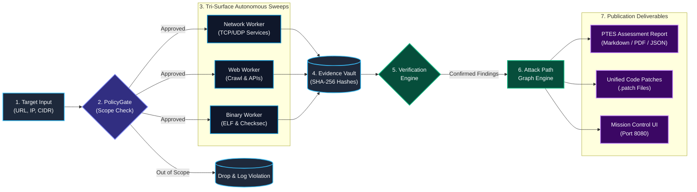
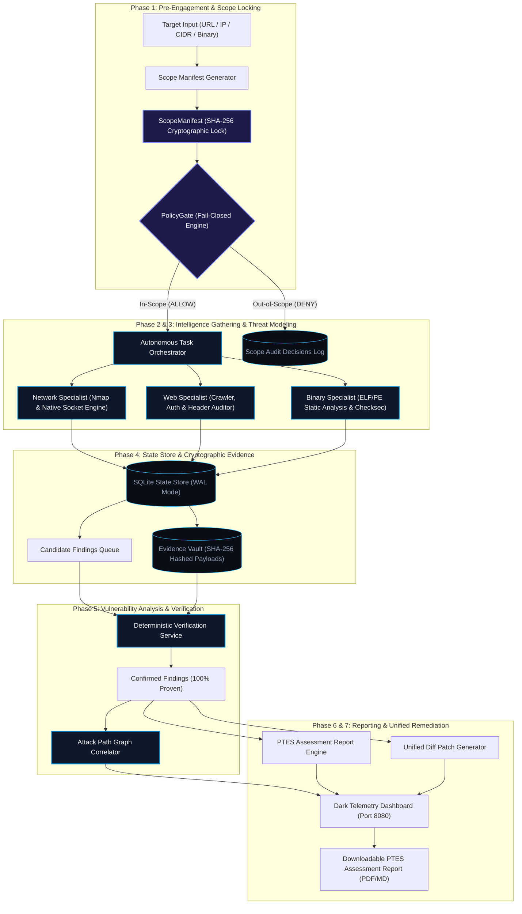
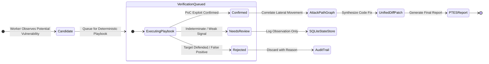

# CyberForge CART
### Controlled Autonomous Red Teaming & Assessment Engine

[](http://www.pentest-standard.org/)
[](docs/safety.md)
[](src/cart/verify.py)
[](tests/test_cart.py)
[](pyproject.toml)
[](Dockerfile)

---

## 🎯 Executive Overview

**CyberForge CART** (Controlled Autonomous Red Teaming) is an enterprise-grade autonomous penetration testing and assessment engine designed for organiser-designated CTF competitions, hybrid cloud laboratories, and enterprise network perimeters.

CART automates the complete penetration testing lifecycle in strict compliance with the **Penetration Testing Execution Standard (PTES)**. It autonomously investigates three concurrent attack vectors: **Network Services**, **Web Applications**, and **Native Compiled Binaries**.

```
                        ┌────────────────────────────────────────┐
                        │          CYBERFORGE CART ENGINE        │
                        └───────────────────┬────────────────────┘
                                            │
               ┌────────────────────────────┼────────────────────────────┐
               ▼                            ▼                            ▼
      🌐 NETWORK SERVICES          🕸️ WEB APPLICATIONS          ⚙️ COMPILED BINARIES
   • Full TCP (1-65535)         • Origin-pinned crawling      • Static ELF/PE header analysis
   • Full UDP with timeouts     • Auth & CSRF token auditing  • Checksec (NX, PIE, Canary, RELRO)
   • Banner fingerprinting      • Reverse-proxy spoofing      • Unsafe libc symbol detection
   • Cleartext service alerts   • Sensitive file exposure     • XOR algorithm & flag hunter
```

Unlike fragile LLM-only scanners that hallucinate findings and leak traffic out-of-scope, CART is built on **Deterministic State Ownership**: scheduling, scope enforcement, task deduplication, evidence cryptographic hashing, and vulnerability verification are handled entirely by deterministic Python algorithms and an ACID-compliant SQLite WAL state store. 

---

## 💡 What Does CyberForge CART Do?

CyberForge CART acts as a senior penetration testing team operating at machine speed with mathematical safety guarantees:

| Capability | What It Does | Why It Matters |
| :--- | :--- | :--- |
| **🛡️ Fail-Closed PolicyGate** | Intercepts 100% of outbound socket handshakes and HTTP requests. Blocks any traffic not explicitly authorized in the locked scope manifest. | Zero risk of legal liability, collateral damage, or scanning unintended targets. |
| **🔍 Tri-Surface Discovery** | Concurrently explores network services (TCP/UDP), web applications (crawling, forms, headers), and binary artifacts (ELF/PE). | Eliminates siloed scans; discovers attack vectors that cross between web, network, and binary layers. |
| **⚖️ Deterministic Verification** | Every candidate vulnerability is tested by an isolated verification playbook before being accepted. | Eliminates false-positive fatigue. Zero hallucinations. |
| **🔗 Attack Path Correlation** | Synthesizes confirmed findings into chained lateral movement and privilege escalation graphs. | Shows decision-makers exactly how an attacker breaches the perimeter and reaches high-value targets. |
| **🛠️ Automated Unified Patches** | Automatically generates Git-appliable unified diff patches (`.patch`) for discovered vulnerabilities. | Developers can review and apply fixes in seconds (`git apply`). |
| **📊 Publication-Grade Reports** | Generates executive summaries, CVSS severity breakdowns, and PTES technical writeups in Markdown, JSON, and PDF. | Ready for boardroom presentations, compliance audits, and security operations teams. |
| **🖥️ Real-Time Mission UI** | Provides a real-time dark HUD dashboard with interactive attack graphs, live logs, and instant target presets. | Complete real-time situational awareness during red team assessments. |

---

## 📐 System Architecture & Workflow

### 1. Simplified End-to-End Workflow

This diagram illustrates how an assessment flows through CART from initial target input to the final report:



---

### 2. Comprehensive System Architecture



---

### 3. Finding Verification State Machine

In CART, no vulnerability is reported on mere suspicion. Findings strictly follow this state progression:



---

## 🔬 In-Depth Component Breakdown

### 1. Zero-Trust PolicyGate (`src/cart/scope.py`)
- **Fail-Closed by Design**: Denies all network traffic unless explicitly matched by approved CIDR prefixes, hostnames, or URLs.
- **DNS Rebinding & Resolution Guards**: Resolves hostnames before checking against allowed ranges; caches resolved IP addresses to protect against TOCTOU rebinding attacks.
- **Memory-Safe CIDR Streaming**: Evaluates large subnets (e.g. `/8`, `/16`) using lazy iterators (`itertools.islice`) rather than materializing millions of IP objects into RAM.
- **Audit Logging**: Every single `ALLOW` or `DENY` decision is timestamped and recorded in SQLite for compliance audit trails.

### 2. Tri-Surface Specialized Workers (`src/cart/workers/`)
- **Network Worker (`network.py`)**:
  - Dual engine: High-performance Nmap scanner with seamless fallback to a pure Python multi-threaded socket engine.
  - Full TCP range support (ports 1–65535) and configurable full UDP scanning with dedicated timeouts (`udp_timeout_s`).
  - Sliding-window bounded job submission (`concurrent.futures`) preventing memory exhaustion on massive port ranges.
  - Automatic banner harvesting, version fingerprinting, and cleartext protocol alerting (FTP, Telnet, HTTP, etc.).
- **Web Worker (`web.py`)**:
  - Scope-guarded recursive crawler with origin pinning and automatic boundary redirection blocking.
  - Full certificate chain and hostname verification on HTTPS connections while pinning destination IPs.
  - Audits security headers (`HSTS`, `CSP`, `X-Frame-Options`, `X-Content-Type-Options`).
  - Reverse proxy trust boundary testing (X-Forwarded-For spoofing).
  - Identifies state-altering HTML forms lacking CSRF protection.
  - Discovers exposed internal artifacts, directory listings (`/vault/`), and robots.txt disclosures.
- **Binary Worker (`binary.py`)**:
  - Direct structural parsing of ELF32/ELF64 and PE executable headers.
  - Checksec hardening compiler inspection: Non-Executable Stack (`NX`), Position Independent Executable (`PIE`), Stack Smashing Protector (`Canary`), and Relocation Read-Only (`RELRO`).
  - Detection of dangerous, unbounded C standard library functions (`strcpy`, `system`, `gets`, `sprintf`, `popen`).
  - Embedded CTF flag discovery and symmetric XOR passkey reversing.

### 3. Deterministic Verification Service (`src/cart/verify.py`)
- Eliminates false positives by executing target-specific, deterministic verification playbooks.
- Only findings with concrete, repeatable proof-of-concept evidence are promoted to `CONFIRMED`.
- Items with insufficient evidence are classified as `NEEDS_REVIEW` or `REJECTED`, protecting report accuracy.

### 4. Attack Path Engine (`src/cart/attackpath.py`)
- Evaluates discovered relationships across network, web, and binary assets.
- Enforces strict evidence grounding: relationships with matching verified exploit proof are scored with `high` confidence, while coexisting assets without explicit exploit chains are transparently labeled as `hypothesis`.

### 5. Remediation Advisor & Unified Patches (`src/cart/advisor.py`)
- Maps confirmed vulnerabilities to standardized CWE and CVSS v3.1 vectors.
- Produces actionable, Git-appliable unified diff patches (`.patch`) so engineering teams can remediate vulnerabilities with a single command.

---

## 🚀 Quick Start Guide

### Option 1: Docker Deployment (Recommended)

CyberForge CART provides a self-contained container environment with Nmap, Binutils, Python 3.11+, and all dependencies pre-installed.

#### Using Docker Compose
```bash
# 1. Clone the repository
git clone https://github.com/EDITH-KRP/MITIGATA_Hackthon.git
cd MITIGATA_Hackthon

# 2. Build and launch the container
docker compose up --build -d

# 3. View live operational logs
docker compose logs -f
```

Open your browser at: **`http://localhost:8080`**

---

### Option 2: Native Host Installation

#### Prerequisites
- **Python**: 3.11, 3.12, or 3.13
- **Tools** *(Optional for enhanced scanning)*: `nmap`, `readelf`, `strings`

```bash
# 1. Clone repository
git clone https://github.com/EDITH-KRP/MITIGATA_Hackthon.git
cd MITIGATA_Hackthon

# 2. Create and activate a virtual environment
python -m venv .venv

# On Linux / macOS:
source .venv/bin/activate

# On Windows (PowerShell):
.\.venv\Scripts\Activate.ps1

# 3. Install in editable mode with development dependencies
pip install -e .[dev]

# 4. Launch the Mission Control Dashboard
python -m cart.cli ui --port 8080
```

---

## 💻 CLI Commands & Usage

CyberForge CART includes a full-featured command-line interface:

```bash
# Run system preflight check (verifies tools, permissions, and database)
python -m cart.cli preflight

# Launch an assessment against a target URL or subnet
python -m cart.cli run --target "http://127.0.0.1:3000" --tier deep

# Scan with full TCP and UDP ranges enabled
python -m cart.cli run --target "192.168.1.100" --all-ports --scan-udp --tier deep

# Generate PTES reports for a specific run ID
python -m cart.cli report --run-id <RUN_ID> --format all

# Start the interactive Mission Control UI
python -m cart.cli ui --host 0.0.0.0 --port 8080
```

---

## 📋 Vulnerability Taxonomy

CyberForge CART detects, verifies, and catalogs weaknesses across standardized security frameworks:

| Vulnerability Type | Severity | PTES Phase | Standard Mapping | Description |
| :--- | :---: | :--- | :--- | :--- |
| `flag_disclosure_pidreq` | **CRITICAL** (9.8) | Exploitation | CWE-639 / CWE-200 | Arbitrary resource dereference via administrative console |
| `binary_missing_nx_stack` | **HIGH** (9.8) | Vulnerability Analysis | CWE-732 / CWE-119 | Missing `GNU_STACK` ELF header permitting stack shellcode execution |
| `binary_unsafe_function` | **HIGH** (9.8) | Vulnerability Analysis | CWE-120 / CWE-676 | Inclusion of dangerous libc symbols (`strcpy`, `system`, `gets`, `popen`) |
| `unauthenticated_console_service` | **HIGH** (8.8) | Vulnerability Analysis | CWE-284 / CWE-306 | Cleartext TCP management console exposed without encryption |
| `reverse_proxy_ip_spoofing` | **HIGH** (8.6) | Vulnerability Analysis | CWE-290 | IP boundary bypass via spoofed `X-Forwarded-For` headers |
| `cleartext_http_authentication` | **HIGH** (8.8) | Vulnerability Analysis | CWE-319 / CWE-523 | HTTP Basic Authentication credentials sent without TLS |
| `unauthenticated_artifact_vault` | **HIGH** (7.5) | Information Gathering | CWE-552 | Exposed directory index disclosing internal compiled binaries |
| `ctf_planted_flag` | **HIGH** (7.5) | Exploitation | CTF Objective | Embedded or dynamically disclosed capture-the-flag proof token |
| `binary_missing_stack_canary` | **MEDIUM** (7.5) | Vulnerability Analysis | CWE-121 | Stack smashing protection omitted during compilation |
| `binary_no_pie` | **MEDIUM** (7.0) | Vulnerability Analysis | CWE-119 | ASLR bypassed; binary compiled with fixed load address |
| `binary_no_relro` | **MEDIUM** (7.0) | Vulnerability Analysis | CWE-732 | Writable Global Offset Table (GOT) permitting PLT hijacking |
| `weak_reversible_binary_passkey` | **MEDIUM** (6.5) | Vulnerability Analysis | CWE-259 / CWE-327 | Hardcoded symmetric XOR routine permitting credential recovery |
| `form_missing_csrf_token` | **MEDIUM** (5.4) | Vulnerability Analysis | CWE-352 | State-altering HTML POST form lacking anti-CSRF token |
| `clickjacking_missing_frame_options` | **MEDIUM** (5.4) | Vulnerability Analysis | CWE-1021 | Missing `X-Frame-Options` and CSP `frame-ancestors` headers |
| `missing_security_headers` | **MEDIUM** (5.3) | Vulnerability Analysis | CWE-693 | Absence of defensive HTTP response headers (`HSTS`, `CSP`) |
| `cors_wildcard_misconfiguration` | **MEDIUM** (5.3) | Vulnerability Analysis | CWE-346 / CWE-942 | Wildcard CORS origin (`*`) enabling cross-origin exfiltration |

---

## 📂 Project Structure

```
CyberForge_CART/
├── Dockerfile                  # Container definition (Python 3.11 + Nmap + Binutils)
├── docker-compose.yml          # Container orchestration with volume mounts & port bindings
├── pyproject.toml              # Build system, dependencies & test configuration
├── README.md                   # System documentation & technical architecture
├── AGENTS.md                   # Operational guardrails and non-negotiable coding rules
├── src/
│   └── cart/
│       ├── cli.py              # CLI entrypoint (preflight, run, report, ui)
│       ├── scope.py            # Zero-trust fail-closed PolicyGate & ScopeManifest
│       ├── models.py           # Frozen data contracts (Finding, Evidence, Task, Asset)
│       ├── store.py            # SQLite ACID state store with WAL mode
│       ├── orchestrator.py     # Deterministic parallel worker coordinator & scheduler
│       ├── ptes.py             # PTES v1.0 operational phases & state machines
│       ├── verify.py           # Zero false-positive deterministic verification engine
│       ├── attackpath.py       # Evidence-backed lateral movement graph analysis
│       ├── report.py           # Publication-grade Markdown/PDF report generator
│       ├── advisor.py          # Remediation advisor & unified diff patch synthesizer
│       ├── ui.py               # Mission control web UI server & REST API
│       └── workers/
│           ├── network.py      # TCP/UDP scanning, service fingerprinting & socket engine
│           ├── web.py          # Link crawler, HTTPS cert verification & header auditor
│           └── binary.py       # ELF/PE parsing, checksec auditing & symbol extraction
├── reports/                    # Generated PTES reports, JSON dumps & .patch files
├── tests/                      # Comprehensive unit and end-to-end integration test suite
└── docs/                       # Architectural specifications and safety guidelines
```

---

## 🧪 Testing & Verification

Every component is covered by an automated test suite verifying fail-closed scope enforcement, memory safety on massive subnets, TLS hostname validation, and deterministic vulnerability verification:

```bash
# Run the complete test suite
pytest -v

# Run linting and code quality validation
ruff check src/ tests/
```

```
============================= test session starts =============================
platform win32 -- Python 3.13, pytest-9.2.0
rootdir: S:\CyberForge_CART
configfile: pyproject.toml
collected 57 items

tests\test_cart.py ..................................................... [ 92%]
...                                                                      [ 98%]
tests\test_e2e.py .                                                      [100%]
============================== 57 passed in 14.71s =============================
```

---

## 📜 Compliance & Safety Standards

1. **Penetration Testing Execution Standard (PTES v1.0)**: Guides all 7 assessment phases from intelligence gathering to reporting.
2. **Deterministic Evidence Principle**: Findings are `CANDIDATE` until proved by a verification playbook.
3. **Fail-Closed Zero-Trust Networking**: Outbound packets are blocked at the socket level unless explicitly authorized in the locked `ScopeManifest`.
4. **Zero Cloud Lock-in**: Autonomous operation runs completely on-premises with zero external API key requirements.
